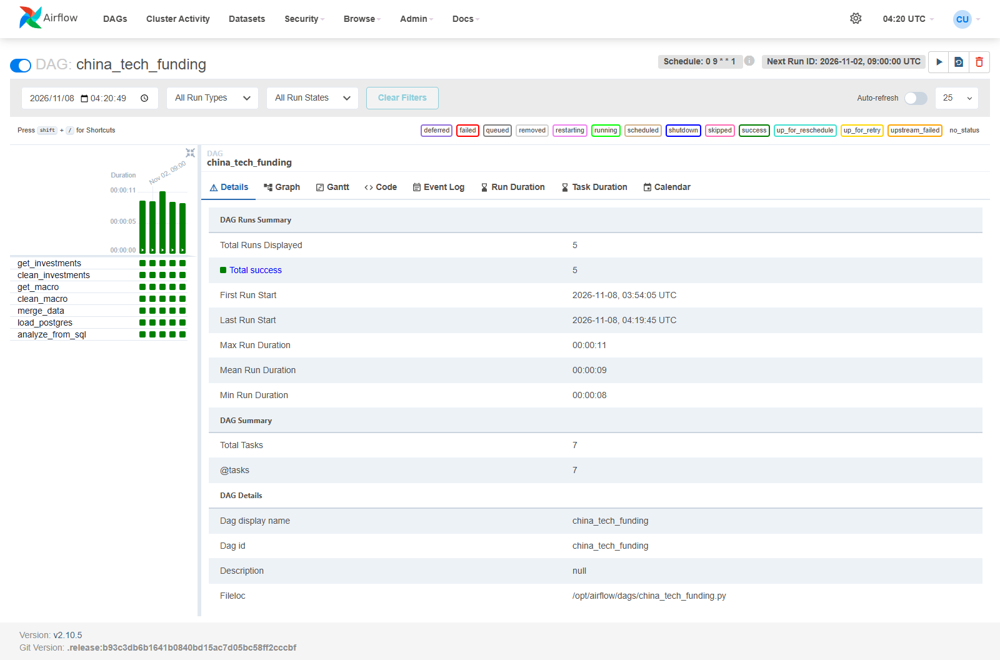
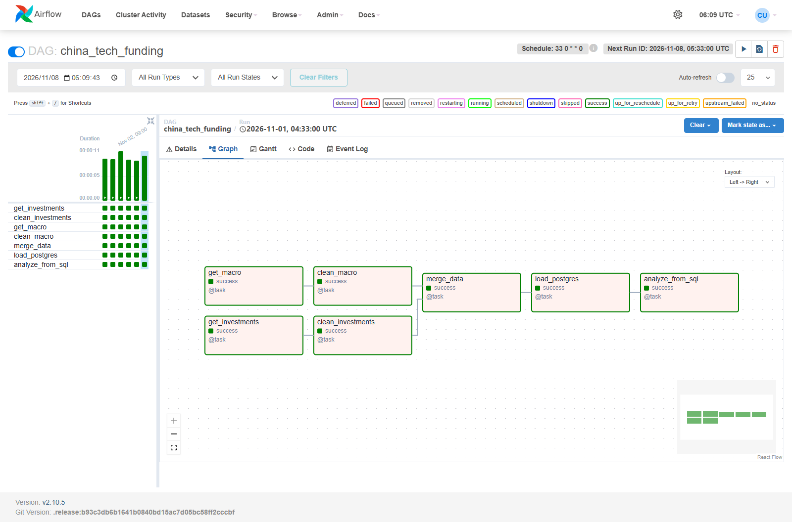
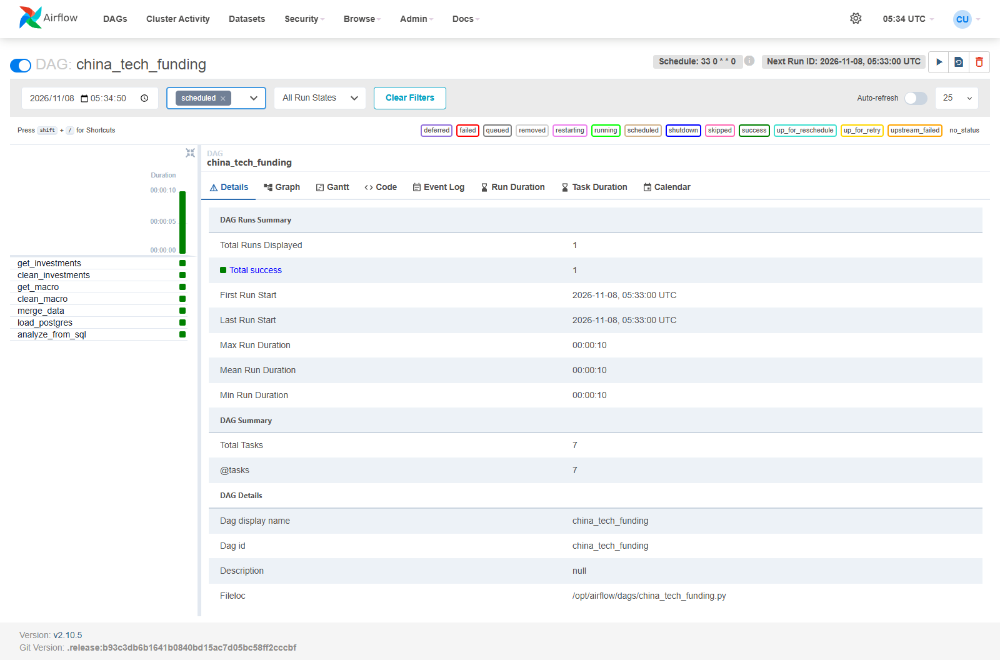
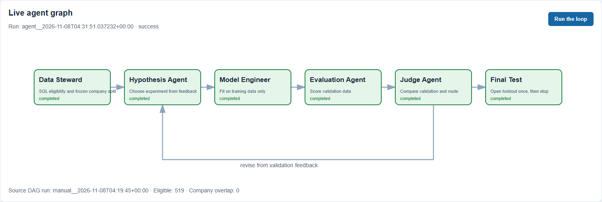
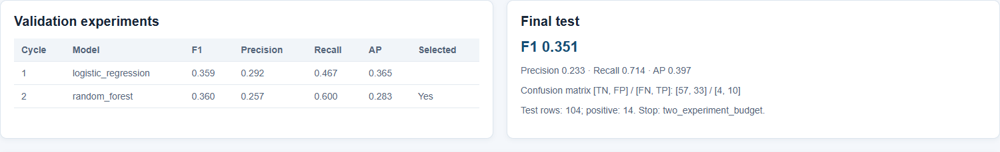
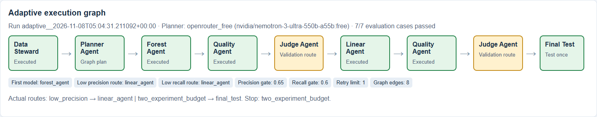
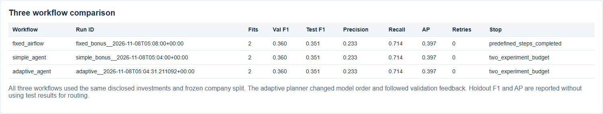

# China tech funding: IDS706 Week 11

[](https://github.com/USERZEROA/china-tech-funding/actions/workflows/ci.yml)

This project studies financing events involving eight Chinese technology investors. It joins [Zenodo investment records](https://zenodo.org/records/19194192) for Chinese Technology & Software investees with [World Bank China GDP growth](https://api.worldbank.org/v2/country/CHN/indicator/NY.GDP.MKTP.KD.ZG?format=json&date=1998:2023&per_page=100) and [GDP per capita](https://api.worldbank.org/v2/country/CHN/indicator/NY.GDP.PCAP.CD?format=json&date=1998:2023&per_page=100). A financing event in year `t` uses macro data from `t-1`.

## Run Part 1

Start Docker Desktop with Linux containers. From this directory:

```powershell
docker compose up --build -d
docker compose exec airflow-webserver airflow dags trigger china_tech_funding
```

Open <http://localhost:8088> and sign in with `admin` / `admin`. The DAG runs every Sunday at 00:33 in the `America/New_York` time zone. The [November 8 scheduled run](artifacts/runs/scheduled__2026-11-01T04_33_00_00_00/run_summary.json) succeeded at 00:33 EST. The two source branches ran in parallel. Each run saves inputs, SHA-256 hashes, cleaning and merge checks, database readback, SQL analysis, and task times under `artifacts/runs/<run_id>/`.

The pipeline retains original investor rows in PostgreSQL, groups plausible funding events, and quarantines conflicting candidates. Zero amounts are treated as undisclosed. The load replaces one validated snapshot in a transaction, so another run does not add duplicate rows.

The [Part 1 run summary](artifacts/runs/manual__2026-11-08T04_19_45_00_00/run_summary.json) records 1,532 selected source rows and 1,428 candidate events. The pipeline checked related records before filtering, quarantined 61 selected rows with unresolved conflicts, and kept 36 outside-scope peers for review. All accepted events matched the prior-year macro data. The repeat load kept 1,428 events in PostgreSQL.

SQL analysis found 1,310 investment events; 365 were in the AI sector (27.9%). Of 519 investments with disclosed amounts, 85 raised at least $100 million (16.4%).

## Run Part 2

```powershell
docker compose up --build -d agent-ui
docker compose exec -T agent-ui python -m src.agent_loop
```

Open <http://localhost:8090> for the agent graph and results. The [Part 2 run summary](artifacts/agent_runs/agent__2026-11-08T04_31_51.037232_00_00/run_summary.json) records 519 disclosed investment events, including 85 at or above $100 million. Its frozen company-grouped split has 315 training, 100 validation, and 104 test rows, with no company overlap. A validation feedback loop compared logistic regression (F1 0.359) with random forest (F1 0.360) and selected the latter. The final test returned F1 0.351, precision 0.233, recall 0.714, AP 0.397, and confusion matrix `[[57, 33], [4, 10]]`. Precision is limited, so these are exploratory results.

The classroom loop was adapted with a Data Steward that checks SQL eligibility and freezes company splits, a Hypothesis Agent that chooses a second model from validation feedback, and a separate Evaluation Agent that scores validation only. The Judge selects by validation F1; a Final Test node opens the holdout once and then stops.

## Run the Bonus comparison

Put an OpenRouter key in the ignored `private/openrouter.env` file as `OPENROUTER_API_KEY=<your key>` for the Planner. Then run the fixed Airflow baseline, the classroom loop, and the adaptive graph:

```powershell
docker compose exec -T airflow-webserver airflow dags unpause funding_fixed_baseline
docker compose exec -T airflow-webserver airflow dags trigger funding_fixed_baseline
docker compose exec -T agent-ui python -m src.agent_loop
docker compose exec -T agent-ui python -m src.adaptive
docker compose exec -T agent-ui python -m src.bonus_eval --fixed '<Airflow run ID>' --simple '<agent run ID>' --adaptive '<adaptive run ID>'
```

Open <http://localhost:8090/bonus> for the workflow graph, evaluation cases, and comparison. The [comparison run](artifacts/bonus_runs/comparison__2026-11-08T05_09_18.116137_00_00/workflow_comparison.json) used the same 519 events, frozen company split, and two model fits per workflow. The Planner chose a forest first, then routed to a linear model after a low precision check. All three workflows reached test F1 0.351 and AP 0.397; this run shows a different route, not a model gain. The [evaluation suite](artifacts/bonus_runs/comparison__2026-11-08T05_09_18.116137_00_00/evaluation_results.json) passed 7/7 cases, including one controlled transient failure recovered after one retry. The three main runs needed no retries.

## Screenshots

### Airflow run



### Airflow graph



### Scheduled Airflow run



### Agent graph



### Model results



### Adaptive execution



### Workflow comparison


